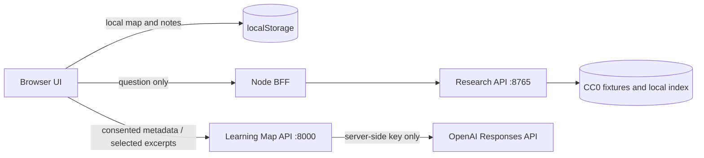
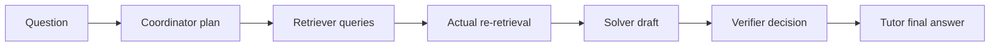

# Math Learning Platform

[日本語](README_JA.md) · [Architecture](docs/architecture.md) · [Evaluation](docs/evaluation.md) · [Security](SECURITY.md)

An evidence-grounded mathematics learning prototype that turns textbook structure into editable learning flowcharts, keeps notes at each concept node, and compares traceable single- and multi-agent retrieval pipelines.

> This is a local research prototype, not a hosted service. AI output is not a guarantee of mathematical correctness or completeness.

## Why this project exists

Intermediate and advanced learners often know their target theorem but not the recursively expanding prerequisites, the right order, or the stopping condition for each topic. Papers and surveys expose mathematical structure but rarely provide a personalized learning route. This project explores whether an editable dependency graph, grounded in user-selected PDF excerpts, can reduce the time required to make that plan.

## What it includes

- Editable concept-dependency flowcharts with node types, learning states, prerequisite warnings, recommended paths, and local persistence.
- Per-node notes, completion criteria, references, understanding checklists, and theorem proof-step review prototypes.
- Browser-side PDF inspection and outline extraction. The whole PDF is not uploaded.
- Explicit two-stage consent before sending metadata and then selected page excerpts to the learning-map API.
- An offline, citation-grounded question panel over checked-in CC0 fixtures.
- Stable document/page/chunk citations that are checked against the actual retrieved set.
- A 27-case, 14-domain CC0 evaluation set with deterministic generation and validation.
- `single-v1` and a data-dependent `multi-pipeline-v2` with structured traces, budgets, retries, and revision metrics.

## Architecture



The three local processes are:

- `apps/web`: React, Vite, PDF.js, KaTeX, and the production-like Node BFF.
- `services/research-api`: deterministic retrieval, citation validation, evaluation, and live single/multi runners.
- `services/learning-map-api`: FastAPI boundary for structured learning-graph generation and review.

The browser never sends node notes or a PDF binary to either Python service. The learning-map service accepts only metadata or page-numbered text selected after explicit consent.

## Single vs. multi-agent evaluation

`single-v1` performs baseline retrieval followed by one model call. `multi-pipeline-v2` uses a directional handoff:



Each role has a distinct strict JSON schema. Retriever output changes the real search query. Solver citations are limited to retrieved chunk IDs; Verifier can permit only those IDs; Tutor can use only the permitted subset and cannot revive a rejected answer. Ground-truth answers and rubrics are introduced only after all model roles finish.

## Published measurements

The checked-in UI result is a four-case **offline deterministic extraction smoke test**, not an LLM benchmark:

| Mode | Cases | Accuracy | Citation precision | Citation recall | Median time | External API cost |
|---|---:|---:|---:|---:|---:|---:|
| Single | 4 | 100% | 100% | 100% | 0.361 ms | $0.0000 |
| Fixed multi-role demo | 4 | 100% | 100% | 100% | 0.370 ms | $0.0000 |

These four deliberately small CC0 cases use deterministic substring/evidence checks and do not establish general mathematical quality or multi-agent superiority. The repository also contains a larger 27-case dataset, but no complete live-LLM comparison over that dataset is published here. **Live OpenAI evaluation: Not run in the published artifacts.**

See [docs/evaluation.md](docs/evaluation.md) for metric definitions, version separation, and the staged live-evaluation procedure.

## Requirements

- macOS or Linux
- Python 3.11 or later
- Node.js 22 and npm
- `curl` for integration smoke tests
- An OpenAI API key only for AI graph generation or explicit live evaluation

## Setup

From the cloned repository root:

```bash
./scripts/setup.sh
```

This creates separate virtual environments for both Python services and installs Web dependencies.

## Run locally

No API key is required for learning maps, browser-side PDF inspection, document-structure fallback, CC0 retrieval, or deterministic evaluation:

```bash
./scripts/dev.sh
```

Open <http://127.0.0.1:5173>. The search API listens on `127.0.0.1:8765`; the learning-map API listens on `127.0.0.1:8000`.

To enable AI graph generation, set the key only in the shell that starts the services:

```bash
read -s "OPENAI_API_KEY?OpenAI API key: "
export OPENAI_API_KEY
echo
export OPENAI_MODEL="gpt-5-mini"
./scripts/dev.sh
```

The key stays server-side. Official OpenAI documentation says API keys must not be exposed in browser code and should be loaded from a server-side environment variable or key-management service: [OpenAI API authentication](https://developers.openai.com/api/reference/overview#authentication).

Optional development ports:

```bash
RESEARCH_API_PORT=18765 LEARNING_MAP_API_PORT=18000 WEB_DEV_PORT=15173 ./scripts/dev.sh
```

## Environment variables

| Variable | Purpose | Default |
|---|---|---|
| `OPENAI_API_KEY` | Server-side API credential; never commit it | unset |
| `OPENAI_MODEL` | Learning-map generation model | `gpt-5-mini` |
| `RESEARCH_API_URL` | Production-like BFF upstream | `http://127.0.0.1:8765` |
| `VITE_LEARNING_MAP_API_URL` | Browser-visible local learning-map API URL | `http://127.0.0.1:8000` |
| `FRONTEND_ORIGIN` | Allowed local CORS origins | local Vite origins |
| `MAX_EVAL_COST_USD` | Live evaluation total budget | runner limit applies |

See [.env.example](.env.example). Do not put a real key in `.env.example`, source control, client-side code, screenshots, or issue reports.

## Checks and builds

Run the complete local validation suite:

```bash
./scripts/check.sh
```

It runs Python Ruff and format checks, both Python test suites, dataset validation, Web lint/tests/build, and a three-service integration smoke test. Individual Web commands are:

```bash
npm ci --prefix apps/web
npm run lint --prefix apps/web
npm test --prefix apps/web
npm run build --prefix apps/web
```

## Deterministic evaluation

```bash
./scripts/evaluate-deterministic.sh
```

This uses only checked-in CC0 fixtures and makes no paid model call.

## Live LLM evaluation

Live evaluation is opt-in and billable. Start with one case, inspect trace and cost, then expand through easy, hard, multi-step, and unanswerable smoke cases before considering all 27 cases. Production comparison uses the same hybrid/top-5 retrieval results for both conditions and a seeded problem-by-trial order:

```bash
export OPENAI_API_KEY="set-in-this-shell-only"
./scripts/evaluate-live.sh --live --mode paired --trials 5 \
  --seed 20260831 --max-total-cost-usd 3.60 \
  --experiment-name production-paired-v6-gpt54mini \
  --output evaluation/runs/gpt54mini-paired-v6.jsonl
```

The runner refuses to call the API without both a process/keychain credential and `--live`. It enforces per-question and total cost, token, step, retry, and timeout limits. Answers and grading rubrics are used only after all model processing.

<!-- LIVE_RESULTS_START -->
実LLM評価: `14d125678646d716`、対応比較135組、multi勝/同点/負=17/101/17、全attempt費用 $0.984281。人手監査は未完了。
<!-- LIVE_RESULTS_END -->

The manual GitHub Actions workflow additionally requires a protected `live-evaluation` Environment and an `OPENAI_API_KEY` environment secret. Do not add that secret unless you intentionally want authorized maintainers to run paid evaluation.

## Repository layout

```text
apps/web/                       React UI and Node BFF
services/research-api/          RAG, citations, datasets, and evaluation
services/learning-map-api/      AI learning-graph generation boundary
docs/                           Architecture, evaluation, and security notes
scripts/                        Root setup, run, check, and evaluation commands
.github/workflows/              Offline CI and manual live evaluation
```

## Security and privacy

- API keys are server-side only and excluded from Git.
- Normal CI has read-only repository permissions and never calls a paid model.
- User PDFs, private runs, local indexes, participant data, and `.env` files are ignored.
- The PDF binary remains in the browser; only explicitly approved excerpts may be sent.
- AI-proposed citations to unsupplied pages are removed or rejected.
- Retrieved PDF text is untrusted evidence, never an instruction or executable tool input.

See [SECURITY.md](SECURITY.md) and [docs/security.md](docs/security.md).

## Known limitations

- No OCR, VLM, authentication, cloud sync, hosted demo, or multi-PDF merge.
- Browser persistence uses localStorage and is device-local.
- PDF support targets documents with a usable text layer and outline.
- AI graph quality and proof-review hints require human verification.
- The 27-case fixture set is synthetic and small compared with real mathematical literature.
- Published measurements do not demonstrate a live-LLM advantage for multi-agent orchestration.
- The Vite build currently reports a chunk-size warning for PDF.js/application bundles.

## Roadmap

- Run repeated, budgeted live single/multi comparisons over representative cases.
- Add larger independently reviewed evaluation sets and human learning-plan studies.
- Improve code splitting and PDF worker loading.
- Add OCR/VLM only after privacy, licensing, and quality evaluation.
- Define a safe deployment boundary before offering any public hosted service.

## Contributing

See [CONTRIBUTING.md](CONTRIBUTING.md). Normal pull requests must not run live paid evaluation or include copyrighted PDFs, user data, secrets, or private traces.

## License

Application code is available under the [MIT License](LICENSE). Original evaluation fixtures under `services/research-api/evaluation/datasets/` are released under CC0-1.0 as declared in their dataset metadata. Third-party components and bundled PDF.js assets retain their own licenses; see [THIRD_PARTY_NOTICES.md](THIRD_PARTY_NOTICES.md).
