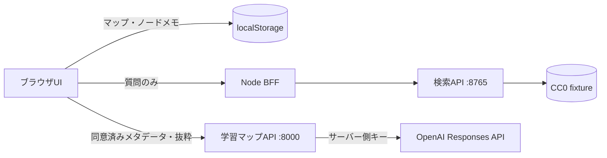

# Math Learning Platform

[English](README.md) · [アーキテクチャ](docs/architecture.md) · [評価](docs/evaluation.md) · [セキュリティ](SECURITY.md)

数学教材の構造から編集可能な学習フローチャートを作り、概念ノードごとのメモを管理し、根拠付きsingle／multi-agent検索を検証するローカル研究プロトタイプです。

> 公開Webサービスではありません。AI出力は数学的な正しさや完全性を保証しません。

## 解決したい課題

中級者以上が定理や専門概念を学ぶとき、前提知識が再帰的に増え、学ぶ順番、必要な理解の深さ、先へ進む停止条件が分かりにくくなります。本プロジェクトは、利用者が確認・編集できる依存グラフとPDF根拠によって、学習計画作成時間を短縮できるか検証します。

## 主な機能

- 概念、定義、例、定理、補題、目標を区別する依存フローチャート
- 学習状態、未完了前提、推奨経路、到達条件、参照文献
- ノード専用メモ、理解チェックリスト、証明ステップレビューUI
- ブラウザ内PDF解析とアウトライン抽出。PDF全体はアップロードしない
- 書誌情報と選択ページ本文について分離された二段階同意
- CC0教材を使う根拠付き質問とdocument/page/chunk引用検証
- 14分野・27問のCC0評価セット
- `single-v1`と、実再検索を行う`multi-pipeline-v2`

## 構成



- `apps/web`: React、Vite、PDF.js、KaTeX、Node BFF
- `services/research-api`: 検索、引用検証、評価、single／multi runner
- `services/learning-map-api`: 構造化された学習グラフ生成・レビュー用FastAPI

ノードメモとPDFバイナリはPythonサービスへ送信しません。学習マップAPIへ送るのは、利用者が明示的に同意したメタデータまたはページ番号付き抜粋だけです。

## データ依存型multi-agent

```text
Question → Coordinator → Retriever → 実再検索
         → Solver → Verifier → Tutor → Final answer
```

各役割は異なるJSON Schemaを使います。Retrieverの出力が実際の検索クエリを変更し、Solverは取得済みchunkだけを引用できます。Verifierはその集合内だけを許可でき、Tutorは許可済み引用と修正指示だけを使います。正解と採点rubricは全モデル処理終了後にのみ使用します。

## 公開中の実測値

完全な本番対応比較では、両条件に同じhybrid/top-5検索結果を渡し、
`gpt-5.4-mini-2026-03-17`を用いて27問を各5回、135組で比較しました。

| 方式 | 実行数 | 正解率 | 引用precision | 引用recall | 中央時間 | API費用 |
|---|---:|---:|---:|---:|---:|---:|
| single call | 135 | 81.5% | 88.9% | 96.3% | 1.648秒 | $0.142476 |
| 5段階multi-agent | 135 | 81.5% | 89.6% | 96.3% | 13.909秒 | $0.828224 |

multi勝／同点／負は17／101／17でした。正解率は同じまま、multiは費用が約5.8倍、
中央値レイテンシが約8.4倍だったため、この課題と根拠集合ではsingleを既定とします。
人手盲検監査は未完了であり、自作fixtureと自動採点の結果を一般的な数学性能や
すべてのmulti-agent構成へ一般化しません。詳細は
[英語Technical Report](docs/technical-report.md)と
[評価結果](services/research-api/evaluation/LIVE_RESULTS.md)を参照してください。

## 必要環境

- macOSまたはLinux
- Python 3.11以上
- Node.js 22とnpm
- 結合テスト用の`curl`
- AI生成またはlive評価を行う場合だけOpenAI APIキー

## セットアップと起動

clone後のリポジトリルートで実行します。

```bash
./scripts/setup.sh
./scripts/dev.sh
```

<http://127.0.0.1:5173>を開きます。APIキーなしでも、学習マップ、PDF基本解析、文書構造フォールバック、CC0検索、決定論的評価を利用できます。

AI概念マップ生成を使う場合は、起動する同じshellだけにキーを設定します。

```bash
read -s "OPENAI_API_KEY?OpenAI APIキーを入力: "
export OPENAI_API_KEY
echo
./scripts/dev.sh
```

キーはサーバー側だけで使用します。OpenAI公式ドキュメントも、APIキーをブラウザへ公開せず、サーバー側の環境変数または秘密管理機構から読み込むよう案内しています: [OpenAI API authentication](https://developers.openai.com/api/reference/overview#authentication)。

使用中のポートを避ける場合:

```bash
RESEARCH_API_PORT=18765 LEARNING_MAP_API_PORT=18000 WEB_DEV_PORT=15173 ./scripts/dev.sh
```

環境変数の例は[.env.example](.env.example)にあります。実キーを`.env.example`、ソースコード、ブラウザ、Issue、スクリーンショットへ記録しないでください。

## 検査

```bash
./scripts/check.sh
```

両PythonサービスのRuff・format・テスト、評価セット検証、Web lint・テスト・build、3サービス結合smokeを実行します。

## 決定論的評価

```bash
./scripts/evaluate-deterministic.sh
```

同梱CC0 fixtureだけを使い、有料APIは呼びません。

## 実LLM評価

実LLM評価は任意で、料金が発生します。最初に1問だけ実行し、traceと費用を確認してください。

```bash
export OPENAI_API_KEY="このshellだけに設定"
./scripts/evaluate-live.sh --live --mode live-multi \
  --case-id arith-percent-001 --limit 1 \
  --max-total-cost-usd 0.20 \
  --output evaluation/runs/pipeline-smoke.jsonl
```

環境キーと`--live`の両方がなければrunnerはAPIを呼びません。問題単位・全体の費用、token、step、retry、timeout上限があります。raw runはGit対象外です。

手動GitHub Actionsから実行する場合、保護された`live-evaluation` Environmentと、そのEnvironmentに登録した`OPENAI_API_KEY` secretが必要です。意図的に有料評価を許可する場合だけ登録してください。

## セキュリティとプライバシー

- 通常CIの権限はread-onlyで、有料APIを呼ばない
- `.env`、利用者PDF、ローカルindex、被験者データ、private runをGit対象外にする
- PDF全体と未選択ページを外部送信しない
- AIが未送信ページを根拠にした場合は引用を除去または拒否する
- PDF本文中の命令を実行指示として扱わない

詳細は[SECURITY.md](SECURITY.md)と[docs/security.md](docs/security.md)を参照してください。

## 既知の制約

- OCR、VLM、認証、クラウド同期、公開デモ、複数PDF統合は未実装
- localStorage保存のため端末間同期はない
- テキスト層とアウトラインを持つPDFが主対象
- AI候補と証明レビューには人間の確認が必要
- 27問セットは実数学文献に比べて小さな合成fixture
- Vite buildでPDF.js／アプリbundleのchunk-size警告が残る

## 今後

- 用意済みの盲検人手監査を完了し、評価者間一致を報告する
- 独立レビュー済み評価セットと利用者による学習計画評価を追加する
- 記録済み失敗例に対して、必要時だけ動くVerifierと修正方式を比較する
- PDF workerとアプリbundleのcode splittingを改善する
- 公開ホスティング前に認証、レート制限、アップロード隔離を設計する

## コントリビューションとライセンス

[CONTRIBUTING.md](CONTRIBUTING.md)を参照してください。アプリコードは[MIT License](LICENSE)です。評価fixtureはdataset metadata記載のCC0-1.0、第三者依存とPDF.js同梱資産はそれぞれのライセンスに従います。詳細は[THIRD_PARTY_NOTICES.md](THIRD_PARTY_NOTICES.md)を参照してください。
